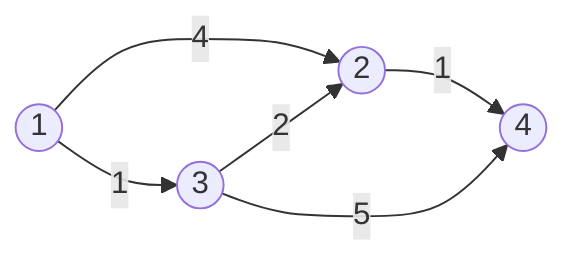
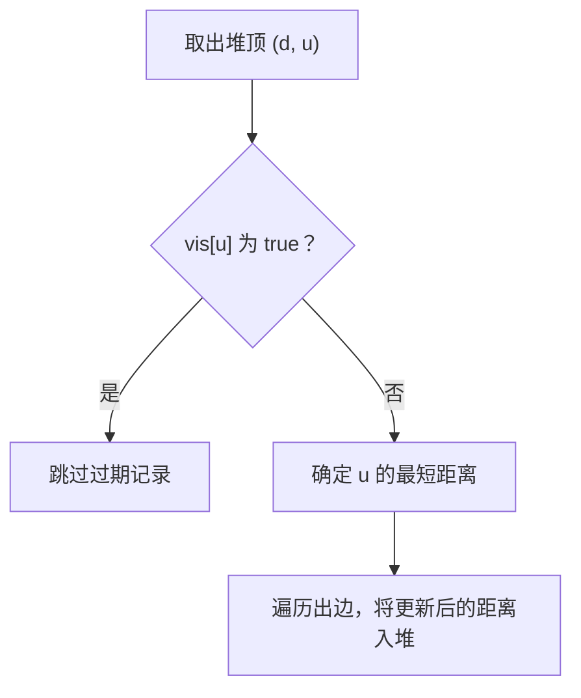
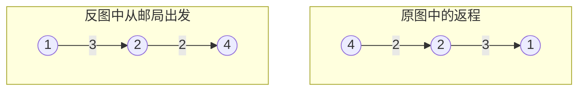
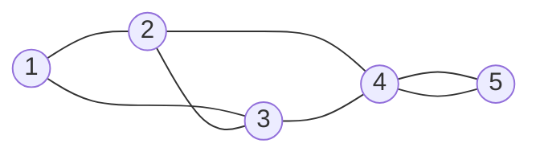

# 图论基础：Dijkstra 最短路

## 一、什么是单源最短路？

给定起点 $s$，求它到每个顶点的最短距离，这就是**单源最短路**。路径的长度是经过的边权之和。Dijkstra 算法适用于**边权非负**的图，有向图和无向图都可以使用。



从 1 到 4，走 $1 \to 2 \to 4$ 的长度为 $5$，走 $1 \to 3 \to 2 \to 4$ 的长度为 $4$。在带权图中，经过更多条边的路径也可能更短。无权图的每条边都可以看作长度为 1，用 BFS 按层扩展就能求最短路。

## 二、Dijkstra 的基本原理

### 1. 松弛与贪心

用 `dist[u]` 记录目前找到的从起点到 $u$ 的最短距离。初始时 `dist[s] = 0`，其余距离设为无穷大。对于一条边 $u \to v$，如果经过 $u$ 能走得更短，就更新 $v$ 的距离。这个操作叫作**松弛**。

$$
\operatorname{dist}[v] \gets \min(\operatorname{dist}[v], \operatorname{dist}[u] + w)
$$

上图中，从 1 直接到 2 的距离为 4。处理顶点 3 时，发现 $1 \to 3 \to 2$ 的长度为 $1+2=3$，于是把 `dist[2]` 从 4 更新为 3。

Dijkstra 每轮选择**尚未确定且当前距离最小**的顶点 $u$，确定它的最短距离，再用它的所有出边进行松弛。如果存在一条更短的路到 $u$，沿这条路找到第一个尚未确定的顶点 $x$。它的前驱已经处理过，因此到 $x$ 的这一段路已被松弛过，长度至少为 $\operatorname{dist}[x]$。从 $x$ 到 $u$ 的边权非负，而 $\operatorname{dist}[x] \ge \operatorname{dist}[u]$，所以这条路无法更短。

负边权会破坏这个结论。例如 $s \to A$ 权值为 2，$s \to B$ 权值为 5，$B \to A$ 权值为 $-4$。算法先确定 $A$ 的距离为 2，但经过 $B$ 可以把距离降到 1。

### 2. 小根堆与过期记录

朴素版每轮扫描所有顶点寻找最小值，时间复杂度为 $O(n^2+m)$。堆优化版将候选点以 `{距离, 顶点}` 的形式放进小根堆，每次直接取出当前距离最小的候选点。

每次松弛成功都把新距离入堆，旧记录会留在堆里。用 `vis[u]` 标记顶点 $u$ 的最短距离是否已经确定，出堆时跳过已确定的顶点。



用第一张图模拟。表中的堆元素按弹出优先级列出。

| 操作 | `dist[1..4]` | 堆中的记录（距离，顶点） |
|---|---|---|
| 初始化 | 0, ∞, ∞, ∞ | (0, 1) |
| 确定 1 | 0, 4, 1, ∞ | (1, 3), (4, 2) |
| 确定 3 | 0, 3, 1, 6 | (3, 2), (4, 2), (6, 4) |
| 确定 2 | 0, 3, 1, 4 | (4, 2), (4, 4), (6, 4) |
| 跳过旧记录，确定 4 | 0, 3, 1, 4 | (6, 4) |
| 跳过旧记录 | 0, 3, 1, 4 | 空 |

每条出边最多被扫描一次，每次成功松弛最多增加一条堆记录。因此，允许重边且重复入堆的实现耗时 $O(n+m\log(m+1))$，额外的堆空间最多为 $O(m)$。在简单图中，时间复杂度通常写成 $O((n+m)\log n)$。

---

## 三、例题一、二：洛谷 P4779 与 P3371 单源最短路径

[洛谷 P4779 标准版](https://www.luogu.com.cn/problem/P4779) · [洛谷 P3371 弱化版](https://www.luogu.com.cn/problem/P3371)

### 题目思路

两题都给出有向带权图，使用同一个堆优化模板。邻接表保存 `{终点, 边权}`，堆保存 `{距离, 顶点}`。邻接表里的 `pii` 表示一对整数。取出堆顶 `{d, u}` 后，沿边 `{v, w}` 走到 $v$ 的距离就是 `d + w`。

### C++17 代码（P4779）

```cpp
#include <functional>
#include <iostream>
#include <queue>
#include <utility>
#include <vector>

using namespace std;

#define pii pair<int, int>

const long long INF = 1LL << 60;

vector<long long> dijkstra(int s, const vector<vector<pii>>& g) {
    vector<long long> dist(g.size(), INF);
    vector<bool> vis(g.size(), false);
    priority_queue<pair<long long, int>,
                   vector<pair<long long, int>>,
                   greater<>> q;

    dist[s] = 0;
    q.push({0, s});

    while (!q.empty()) {
        auto [d, u] = q.top();
        q.pop();

        if (vis[u]) {
            continue;
        }
        vis[u] = true;

        for (auto [v, w] : g[u]) {
            if (d + w < dist[v]) {
                dist[v] = d + w;
                q.push({dist[v], v});
            }
        }
    }

    return dist;
}

int main() {
    ios::sync_with_stdio(false);
    cin.tie(nullptr);

    int n, m, s;
    cin >> n >> m >> s;
    vector<vector<pii>> g(n + 1);

    for (int i = 0; i < m; i++) {
        int u, v, w;
        cin >> u >> v >> w;
        g[u].push_back({v, w});
    }

    auto dist = dijkstra(s, g);
    for (int u = 1; u <= n; u++) {
        cout << dist[u] << (u == n ? '\n' : ' ');
    }
    return 0;
}
```

### P3371 的易错点

P4779 保证从起点可达所有顶点。P3371 要求不可达时输出 $2^{31}-1$，所以做 P3371 时，将上面 `main` 中的输出循环替换为下面这段。

```cpp
for (int i = 1; i <= n; i++) {
    if (dist[i] == INF) {
        cout << 2147483647;
    } else {
        cout << dist[i];
    }
    cout << (i == n ? '\n' : ' ');
}
```

调试时写过 `2e31 - 1`。C++ 的 `2e31` 是科学计数法，表示 $2 \times 10^{31}$。这里要的是整数 `2147483647`。例如只有 $1 \to 2$（权值 3）和 $2 \to 3$（权值 5）的四点图，从 1 出发应输出 `0 3 8 2147483647`。

---

## 四、例题三：洛谷 P1339 热浪

[洛谷 P1339 Heat Wave G](https://www.luogu.com.cn/problem/P1339)

### 题目思路

输入给出起点 $s$ 和终点 $t$。每条道路都可以双向通行，读入 $u,v,w$ 时，分别向 `g[u]` 和 `g[v]` 加边。最后只输出 `dist[t]`。

### C++17 代码

保留 P4779 中 `main` 前面的代码，只替换 `main`。

```cpp
int main() {
    ios::sync_with_stdio(false);
    cin.tie(nullptr);

    int n, m, s, t;
    cin >> n >> m >> s >> t;
    vector<vector<pii>> g(n + 1);

    for (int i = 0; i < m; i++) {
        int u, v, w;
        cin >> u >> v >> w;
        g[u].push_back({v, w});
        g[v].push_back({u, w});
    }

    auto dist = dijkstra(s, g);
    cout << dist[t] << '\n';
    return 0;
}
```

---

## 五、例题四：洛谷 P1629 邮递员送信

[洛谷 P1629 邮递员送信](https://www.luogu.com.cn/problem/P1629)

### 题目思路

每送完一件物品，都要回到邮局 1。每次往返相互独立，答案是各目的地的**去程最短距离加返程最短距离**之和。

去程可以直接在原图上从 1 跑一次 Dijkstra。返程的终点都是 1，将原图的每条边反向并保留权值，就能把每条 $u \to 1$ 的路径变成反图上的 $1 \to u$ 路径，长度保持相同。因此返程也可以从 1 一次求出。



### C++17 代码

沿用 P4779 的模板，替换 `main`。`g` 存原图，`rg` 存反图。从 1 出发各跑一次，`dist1[u]` 是去程，`dist2[u]` 是返程。

```cpp
int main() {
    ios::sync_with_stdio(false);
    cin.tie(nullptr);

    int n, m;
    cin >> n >> m;
    vector<vector<pii>> g(n + 1), rg(n + 1);

    for (int i = 0; i < m; i++) {
        int u, v, w;
        cin >> u >> v >> w;
        g[u].push_back({v, w});
        rg[v].push_back({u, w});
    }

    auto dist1 = dijkstra(1, g);
    auto dist2 = dijkstra(1, rg);
    long long ans = 0;

    for (int u = 2; u <= n; u++) {
        ans += dist1[u] + dist2[u];
    }
    cout << ans << '\n';
    return 0;
}
```

---

## 六、例题五：洛谷 P1144 最短路计数

[洛谷 P1144 最短路计数](https://www.luogu.com.cn/problem/P1144)

### 题目思路

用 `dist[u]` 记录最短距离，用 `ans[u]` 记录最短路径条数。初始化 `dist[1] = 0`，`ans[1] = 1`，表示留在起点有一条长度为 0 的路径。遍历边 $u \to v$ 时，候选距离为 `dist[u] + 1`。

- 候选距离更短时，用 `ans[u]` 覆盖 `ans[v]`，因为原有路径已不再最短。
- 候选距离相等时，把 `ans[u]` 加到 `ans[v]`，对 $100003$ 取模。
- 候选距离更长时，保持原有距离和方案数。



样例中，顶点 4 分别从顶点 2 和 3 接收一条最短路径，所以 `ans[4] = 2`。4 到 5 的两条重边各贡献 2 条路径，所以 `ans[5] = 4`。每条边单独存入邻接表，边长始终为 1。

### BFS 写法

本题每条边都等长，BFS 第一次发现顶点时便确定了它的最短距离。当前层会在下一层出队前处理完，等长路径只累加方案数即可。时间复杂度为 $O(N+M)$，适合本题的数据范围。

```cpp
#include <iostream>
#include <queue>
#include <vector>

using namespace std;

const int MOD = 100003;

int main() {
    ios::sync_with_stdio(false);
    cin.tie(nullptr);

    int N, M;
    cin >> N >> M;
    vector<vector<int>> g(N + 1);

    for (int i = 0; i < M; i++) {
        int x, y;
        cin >> x >> y;
        g[x].push_back(y);
        g[y].push_back(x);
    }

    vector<int> dist(N + 1, -1);
    vector<int> ans(N + 1, 0);
    queue<int> q;

    dist[1] = 0;
    ans[1] = 1;
    q.push(1);

    while (!q.empty()) {
        const int u = q.front();
        q.pop();

        for (int v : g[u]) {
            if (dist[v] == -1) {
                dist[v] = dist[u] + 1;
                ans[v] = ans[u];
                q.push(v);
            } else if (dist[v] == dist[u] + 1) {
                ans[v] = (ans[v] + ans[u]) % MOD;
            }
        }
    }

    for (int u = 1; u <= N; u++) {
        cout << ans[u] << '\n';
    }
    return 0;
}
```

### Dijkstra 写法

沿用上面的无权邻接表、读入和输出。补上 `<functional>` 和 `<utility>`，将 `main` 中从 `dist`、`ans` 的初始化到搜索结束的部分替换为下面这段。最短路最多经过 $N-1$ 条边，所以可以用 $N+1$ 表示不可达。

```cpp
vector<int> dist(N + 1, N + 1);
vector<int> ans(N + 1, 0);
priority_queue<pair<int, int>, vector<pair<int, int>>, greater<>> q;

dist[1] = 0;
ans[1] = 1;
q.push({0, 1});

while (!q.empty()) {
    auto [d, u] = q.top();
    q.pop();

    if (d != dist[u]) {
        continue;
    }

    for (int v : g[u]) {
        if (d + 1 < dist[v]) {
            dist[v] = d + 1;
            ans[v] = ans[u];
            q.push({dist[v], v});
        } else if (d + 1 == dist[v]) {
            ans[v] = (ans[v] + ans[u]) % MOD;
        }
    }
}
```

边权都是 1，所以最短路上的前驱距离严格更小，都会先于当前顶点出堆。这个次序保证方案数收集完毕后才向下一层传递。

---

## 七、例题六：洛谷 P1828 香甜的黄油

[洛谷 P1828 香甜的黄油](https://www.luogu.com.cn/problem/P1828)

### 题目思路

枚举放糖的牧场 $s$，从 $s$ 跑一次 Dijkstra。道路是双向的，牧场 $s$ 到 $u$ 的最短距离也就是牧场 $u$ 的奶牛走到 $s$ 的距离。用 `cow[i]` 记录第 $i$ 头奶牛所在的牧场。依次累加每头牛要走的距离，即使几头牛住在同一处，也会分别算进去。

$$
\operatorname{sum}(s) = \sum_{i=1}^{N} \operatorname{dist}[\operatorname{cow}[i]]
$$

样例中，奶牛在 2、3、4 号牧场。2 到 3 的直接道路长度为 7，经过 1 的最短距离为 6。

| 放糖的牧场 | 2、3、4 号牧场的奶牛行走距离 | 总距离 |
|---|---|---|
| 1 | 1 + 5 + 4 | 10 |
| 2 | 0 + 6 + 3 | 9 |
| 3 | 6 + 0 + 5 | 11 |
| 4 | 3 + 5 + 0 | 8 |

### C++17 代码

沿用 P4779 的模板，替换 `main`。若某个有奶牛的牧场不可达，就跳过本次放糖位置。

```cpp
int main() {
    ios::sync_with_stdio(false);
    cin.tie(nullptr);

    int N, P, C;
    cin >> N >> P >> C;
    vector<int> cow(N + 1);
    for (int i = 1; i <= N; i++) {
        cin >> cow[i];
    }

    vector<vector<pii>> g(P + 1);
    for (int i = 0; i < C; i++) {
        int A, B, D;
        cin >> A >> B >> D;
        g[A].push_back({B, D});
        g[B].push_back({A, D});
    }

    long long ans = INF;
    for (int s = 1; s <= P; s++) {
        auto dist = dijkstra(s, g);
        long long sum = 0;
        for (int i = 1; i <= N; i++) {
            if (dist[cow[i]] == INF) {
                sum = INF;
                break;
            }
            sum += dist[cow[i]];
        }
        if (sum < ans) {
            ans = sum;
        }
    }

    cout << ans << '\n';
    return 0;
}
```

枚举 $P$ 个牧场，每次在 $C$ 条双向道路上求最短路，再累加 $N$ 头奶牛的距离。总时间复杂度为 $O(P(P+C\log(C+1)+N))$。

---

## 八、总结

1. 非负边权保证了 Dijkstra 每次取出的最短候选距离可以确定，堆中旧记录出堆时直接跳过。
2. 无向边在邻接表中存两个方向。遇到有向图中多个起点通往同一终点的问题，可以反向建图，从这个终点出发统一计算。
3. 最短路计数遵循「更短覆盖，等长累加」。每条边等长时，用 BFS 按层传递方案数。
4. 汇合点未知时，先确定怎样计算一个候选点的代价，再枚举候选点并取最小值。
