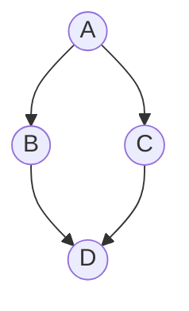
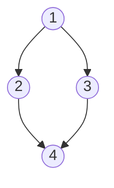
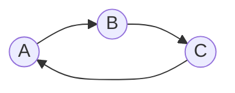
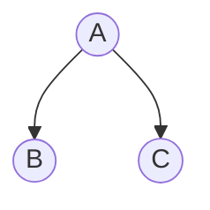
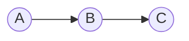

# 图论基础：拓扑排序

## 一、什么是拓扑排序？

拓扑排序（Topological Sort）是对**有向无环图（DAG）**中的顶点进行排序，使得对于每条有向边 $u \rightarrow v$，顶点 $u$ 都必须出现在顶点 $v$ 之前。

例如，在完成任务 B、C 之前必须先完成 A，而任务 D 必须等待 B、C 完成。



可以得到两种合法的拓扑序：

- A → B → C → D
- A → C → B → D

因此，**拓扑排序的结果不一定唯一。**

需要注意的是，只有有向无环图才能完成拓扑排序。如果图中存在环，就无法找到满足所有边的先后顺序。

## 二、拓扑排序的基本原理

### 1. 入度与出度

对于一条有向边 $u \rightarrow v$：

- 入度（Indegree）：指向某个顶点的边数。
- 出度（Outdegree）：从某个顶点出发的边数。

拓扑排序的核心是寻找**入度为 0 的顶点**，因为这些顶点没有尚未完成的前置依赖，可以优先处理。

### 2. Kahn 算法（队列实现）

算法流程：

1. 统计每个顶点的入度。
2. 将所有入度为 0 的顶点加入队列。
3. 取出队首顶点，将其加入拓扑序列。
4. 遍历它指向的所有顶点，将这些顶点的入度减一。
5. 如果某个顶点的入度变为 0，就将其加入队列。
6. 重复以上步骤，直到队列为空。

下面使用一个简单的有向无环图演示：



各顶点初始入度：

| 顶点 | 1 | 2 | 3 | 4 |
|---|---|---|---|---|
| 入度 | 0 | 1 | 1 | 2 |

假设队列按照先进先出的顺序处理：

| 操作 | 操作后的队列 | 已输出序列 |
|---|---|---|
| 初始化 | 1 | 空 |
| 取出 1 | 2, 3 | 1 |
| 取出 2 | 3 | 1, 2 |
| 取出 3 | 4 | 1, 2, 3 |
| 取出 4 | 空 | 1, 2, 3, 4 |

最终拓扑序为 `1 2 3 4`。

### 3. 如何判断是否存在环？

如果拓扑排序结束后，输出的顶点数量小于图的顶点总数，则图中一定存在有向环。



在这个图中，所有顶点的入度均为 1，没有任何顶点能够进入初始队列。

因此，无法完成拓扑排序。

特别注意：**孤立点不会导致拓扑排序失败。** 孤立点的入度为 0，同样会加入初始队列。

### 4. 时间复杂度

使用邻接表存图，每个顶点入队、出队一次，每条边被遍历一次。

因此时间复杂度为：

$$
O(n+m)
$$

其中 $n$ 为顶点数，$m$ 为边数。

---

## 三、例题一：洛谷 B3644 拓扑排序 / 家谱树

[题目链接：B3644](https://www.luogu.com.cn/problem/B3644)

### 题目思路

给定一个家族中每个人的后代关系，要求输出一个排列，使得每个人都出现在自己的后代之前。

将每个人看作图中的顶点，如果 $v$ 是 $u$ 的后代，就建立有向边 $u \rightarrow v$。

这是一道标准的拓扑排序模板题，使用邻接表与队列即可解决。

### C++ 代码

```cpp
#include <cstdio>
#include <iostream>
#include <vector>
#include <queue>
using namespace std;

inline int read() {
    int x = 0, f = 1;
    char c = getchar();
    while (c < '0' || c > '9') {
        if (c == '-') f = -1;
        c = getchar();
    }
    while (c >= '0' && c <= '9') {
        x = x * 10 + c - '0';
        c = getchar();
    }
    return x * f;
}

int main() {
    int n = read();
    vector<vector<int>> g(n + 1);
    vector<int> indegree(n + 1, 0);

    for (int u = 1; u <= n; u++) {
        int v;
        while ((v = read()) != 0) {
            g[u].push_back(v);
            indegree[v]++;
        }
    }

    queue<int> q;
    for (int i = 1; i <= n; i++) {
        if (indegree[i] == 0)
            q.push(i);
    }

    vector<int> order;

    while (!q.empty()) {
        int u = q.front();
        q.pop();
        order.push_back(u);

        for (int v : g[u]) {
            indegree[v]--;
            if (indegree[v] == 0)
                q.push(v);
        }
    }

    for (int x : order)
        cout << x << " ";

    cout << '\n';
    return 0;
}
```

### 易错点：while 的运算符优先级

本题调试时，曾将输入循环写成：

```cpp
while (v = read() && v != 0)
```

由于 `&&` 的优先级高于赋值运算符 `=`，表达式并不会按照预期执行，而且还可能在赋值前读取 `v`。

应改为：

```cpp
while ((v = read()) != 0)
```

先读取并赋值，再判断是否为 0。

---

## 四、例题二：洛谷 P1347 排序

[题目链接：P1347](https://www.luogu.com.cn/problem/P1347)

### 题目思路

给出若干个元素之间的大小关系，例如：

```text
A<B
B<C
```

要求根据这些关系判断能否确定全部元素的排序顺序。

与上一道模板题相比，本题需要判断三种情况。

### 情况一：顺序无法唯一确定

假设只有两个关系：

```text
A<B
A<C
```



在取出 A 后，B 和 C 的入度同时为 0。

因此，`ABC` 和 `ACB` 都是合法的拓扑序，无法确定唯一顺序。

**判断方法：如果拓扑排序过程中，队列中曾同时存在两个或更多顶点，则拓扑序不唯一。**

### 情况二：能够确定唯一顺序

如果再加入一条关系 `B<C`：



此时每一步都只能选择一个入度为 0 的顶点。

因此，唯一的拓扑序为 `ABC`。

### 情况三：出现矛盾

如果关系为：

```text
A<B
B<C
C<A
```


此时图中存在有向环，三个关系相互矛盾，不存在合法的拓扑序。

### 算法实现

本题的关键在于**每读入一条新关系，就重新进行一次拓扑排序**，判断当前关系是否已经足以确定顺序，或已经产生矛盾。

判断规则：

- 输出顶点数不足 $n$：出现矛盾。
- 所有顶点均已输出，且队列始终只有一个可选顶点：确定唯一顺序。
- 所有顶点均已输出，但某一步有多个可选顶点：当前顺序不唯一。

为了避免反复修改原图的入度，每次拓扑排序都应复制一份入度数组。

### C++ 代码

```cpp
#include <iostream>
#include <vector>
#include <queue>
#include <string>
using namespace std;

// -1: 矛盾  0: 不唯一  1: 唯一
int topo(int n, const vector<vector<int>>& g,
         const vector<int>& indegree, string& order) {

    vector<int> deg = indegree;
    queue<int> q;
    order.clear();

    for (int i = 0; i < n; i++) {
        if (deg[i] == 0)
            q.push(i);
    }

    bool unique = true;

    while (!q.empty()) {
        if (q.size() > 1)
            unique = false;

        int u = q.front();
        q.pop();

        order += char('A' + u);

        for (int v : g[u]) {
            deg[v]--;
            if (deg[v] == 0)
                q.push(v);
        }
    }

    if ((int)order.size() != n)
        return -1;

    return unique ? 1 : 0;
}

int main() {
    int n, m;
    cin >> n >> m;

    vector<vector<int>> g(n);
    vector<int> indegree(n, 0);

    for (int i = 1; i <= m; i++) {
        string s;
        cin >> s;

        int u = s[0] - 'A';
        int v = s[2] - 'A';

        g[u].push_back(v);
        indegree[v]++;

        string order;
        int state = topo(n, g, indegree, order);

        if (state == -1) {
            cout << "Inconsistency found after "
                 << i << " relations.\n";
            return 0;
        }

        if (state == 1) {
            cout << "Sorted sequence determined after "
                 << i << " relations: "
                 << order << ".\n";
            return 0;
        }
    }

    cout << "Sorted sequence cannot be determined.\n";
    return 0;
}
```

本题中，使用：

```cpp
int u = s[0] - 'A';
int v = s[2] - 'A';
```

将大写字母映射为整数下标，方便使用 `vector` 存图。如果字母编号不是连续的，或者顶点是一般字符串，也可以考虑使用 `map` 建立映射。

本题的时间复杂度为：

$$
O(m(n+m))
$$

因为最多需要进行 $m$ 次拓扑排序，每次的时间复杂度不超过 $O(n+m)$。

---

## 五、总结

今天学习了拓扑排序的基本原理，并通过两道洛谷题进一步理解了它的应用。

需要掌握的几个要点：

1. 拓扑排序适用于有向无环图。
2. 使用入度数组和队列实现 Kahn 算法。
3. 输出顶点数量不足 $n$，说明图中存在环。
4. 拓扑过程中存在多个可选顶点，说明拓扑序不唯一。
5. 对于动态加入关系的题目，可以在每次加入新边后重新判断。

B3644 主要考查基础模板与建图，P1347 则进一步考查拓扑排序的性质和判定。

拓扑排序的本质，是根据有向边所表示的先后依赖关系，构造一个满足所有约束的线性顺序。

掌握这一思想后，就可以进一步学习 DAG 上的动态规划等问题。
